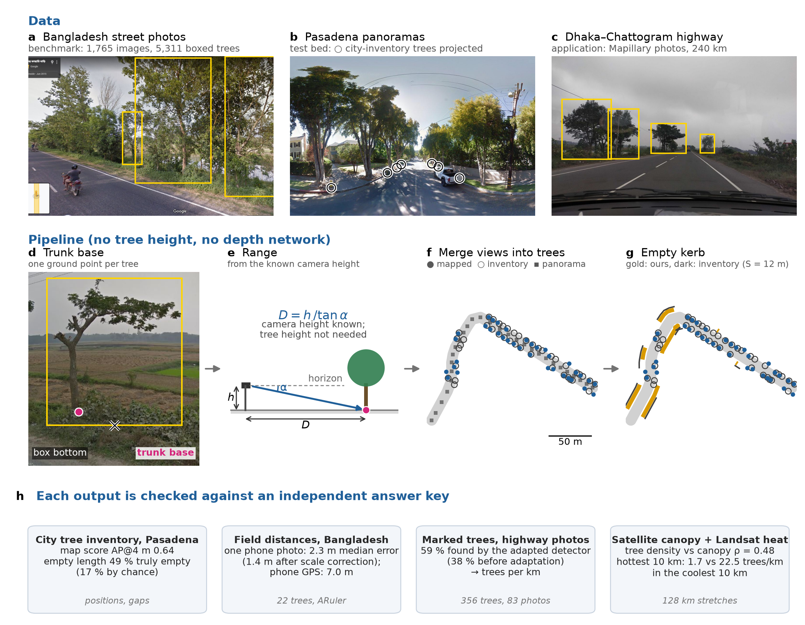

# Roadside tree mapping from street-level images

Code, labels, protocol files and results for the paper

> **Where are roadside trees missing? Validated tree and planting-gap maps from street-level images, with an application to the Dhaka–Chattogram highway.**
> S.M. Tasfik Us Salehin, Fatema Mehnaz, Anima Zaman, Kanak Barua, Md Shahriar Mahbub.
> Department of Computer Science and Engineering, Ahsanullah University of Science and Technology, Dhaka.



The pipeline finds each roadside tree and the point where its trunk meets the ground, turns that point into a map
position from the known camera height (no depth network, no tree height), merges views of the same tree, and measures
the empty kerb length between trees. Every output is checked against an independent reference:

| Output | Reference | Result |
|---|---|---|
| Tree detection (Bangladesh, 1,765 images, route-grouped split) | human boxes | AP50 0.61–0.65 (trained detectors) |
| Trunk-base point | reviewed reference points | 20–22 px vs 53–60 px for the box bottom |
| Map positions (Pasadena test area) | 10,662 city-inventory records | AP@4 m 0.640 (95 % interval 0.568–0.690) |
| Distance from one phone photo (Bangladesh) | 22 ARuler field measurements | median error 2.3 m (1.4 m after scale correction) |
| Planting gaps (Pasadena) | city inventory | 49 % of flagged length truly empty (17 % by chance) |
| Highway transfer (Mapillary photos) | 356 marked trees | 59 % found → tree density per km (rule fixed in advance) |
| Highway tree density | satellite canopy height map | Spearman ρ = 0.48 over 128 km |

## Repository layout

```
src/            pipeline and experiment scripts (geometry, merging, gaps, Pasadena, Mapillary, highway, VLM, heat)
kaggle_jobs/    GPU training and inference jobs (templates + builder that embeds the split and labels)
figures/        scripts that redraw Figures 1–3 from results/ (outputs are committed)
data/           labels and splits made for this study (see data/README.md)
results/        result tables read by the figure scripts and quoted in the paper (see results/README.md)
protocols/      dated decision rules written before each result, with their amendments
audit/          reproduction of the 90.7 % AP50 reported in the earlier version, and its source
```

## Installation

Python 3.10 or newer.

```bash
git clone https://github.com/TashfikS/roadside-tree-mapping.git
cd roadside-tree-mapping
python -m venv .venv && source .venv/bin/activate
pip install -r requirements.txt
export PYTHONPATH=$PWD/src
```

GPU training runs on Kaggle (free tier); everything else runs on a laptop CPU.

## External data

| Data | Where to get it | Environment variable |
|---|---|---|
| Bangladesh street-view images, boxes, field photos | [Kaggle: roadside-trees-of-bangladesh-street-view](https://www.kaggle.com/datasets/tashfiksalehin/roadside-trees-of-bangladesh-street-view) | `BD_DATASET_DIR`, `FIELD_PHOTO_DIR` |
| Pasadena Urban Trees (panoramas, inventory, evaluator) | from the benchmark authors (Wegner et al., 2016; Branson et al., 2018) | `PASADENA_DIR` (folder containing `PasadenaUrbanTrees/` and `PythonAPI/`) |
| Mapillary photos (Pasadena and highway) | Mapillary API v4; image ids are in `data/highway_photos.csv` | `MAPILLARY` (API token), `HIGHWAY_PHOTO_DIR` |
| Canopy height (Meta/WRI, 1 m, v2) | read remotely by `src/chm_corridor.py` | – |
| Landsat 8/9 Collection 2 Level-2 surface temperature | read from the Microsoft Planetary Computer by `src/lst_corridor.py` | – |

Unset variables default to folders under `data/external/` (git-ignored).

## Model weights

Trained weights are attached to the [GitHub release](https://github.com/TashfikS/roadside-tree-mapping/releases)
(file names and SHA-256 checksums in [`weights.md`](weights.md)): the Bangladesh trunk-base model (YOLO11m-pose),
the two Pasadena detectors and the three highway models.

## Reproducing the paper

Run scripts from a scratch folder so that intermediate files stay out of the repository:

```bash
mkdir -p work && cd work
```

| Paper | Step | Command |
|---|---|---|
| §3.1 | route-grouped split, near-duplicate check | Kaggle job `split` |
| §4.1 | automatic trunk-base points (Grounding DINO + SAM) | Kaggle job `trunk_labels`; review with `python ../src/make_review.py` |
| §5.1, Table 3 | detectors (YOLO11, RT-DETR, Faster R-CNN, Grounding DINO, trunk-base model) | Kaggle jobs `pose_s*`, `posel_s*`, `yolo11m_s*`, `yolo832_s*`, `rtdetr_l_s*`, `frcnn`, `gdino_zs` |
| §4.2–4.3 | geometry, merge, Pasadena evaluation | `python ../src/pas_e2.py <weights.pt> <out_prefix>`; geometry tests: `python ../src/test_treegeo.py` |
| §4.1, §5.2 | Pasadena retraining on inventory-verified pseudo-labels | Kaggle jobs `pas_teacher`, then `pas_student`; `python ../src/pas_compare_student.py` |
| §5.2 | monocular depth comparison | `python ../src/pas_e7.py`, `python ../src/pas_e7_scaled.py` |
| §5.2 | Mapillary photos of Pasadena | `python ../src/mly_detect.py`, `python ../src/mly_test.py` |
| §5.3 | distances from field photos | `python ../src/field_distances.py` |
| §4.4, §5.4 | planting gaps and densities | `python ../src/pas_student_gaps.py`, `python ../src/pas_density_student.py` |
| §5.4 | vision–language second look | `python ../src/vlm2_targets.py`, Kaggle job `vlm_gap` |
| §3.4, §5.5 | highway labels, training, test, usability check | `make_hw_packages.py` → `make_hw_labels.py` → `make_hw_train.py` → `hw_test_predict.py` → `hw_score_test.py`; usability check: `usab_features.py` → `hw_usability.py` |
| §5.5 | highway map, canopy, heat ranking | `hw_horizon.py`, `hw_map.py`, `chm_corridor.py`, `lst_corridor.py`, `hw_outputs.py` |
| Figs. 1–3 | figures from `results/` | `python ../figures/make_fig_overview.py` (needs the images), `make_fig_validation.py`, `make_fig_highway.py` |

Kaggle jobs are built with

```bash
python kaggle_jobs/build_jobs.py --user <your-kaggle-username> --out work/kjobs
kaggle kernels push -p work/kjobs/pose_s0
```

See [`kaggle_jobs/README.md`](kaggle_jobs/README.md) for the settings of every run.

## Pre-specified decision rules

Every rule that could be tuned to a test set (split, settings searched on validation data, pass marks and the rule that
decides what the highway map may show) was written into a dated file in [`protocols/`](protocols/) before the result
it governs. Changes are recorded there as numbered amendments, each written before the data it concerns. Failed tests
are reported in the paper with the successful ones.

## Citation

See [`CITATION.cff`](CITATION.cff). Please also cite the Pasadena Urban Trees benchmark when using the Pasadena results.

## Licence

Code: MIT ([`LICENSE`](LICENSE)). Labels and results made for this study: CC BY 4.0 (see [`data/README.md`](data/README.md)).
Street-view imagery is not redistributed here; Mapillary photos are CC BY-SA 4.0 by their contributors.
